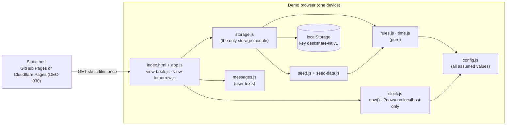

# DeskShare (kit test A) — Architecture

| | |
|---|---|
| **Generated by** | `spec` (BA kit) |
| **Date** | 2026-10-22 |
| **Inputs** | `docs/03-backlog/backlog.md` + `stories/US-001…US-017` (Reviewed; US-001, US-002, US-015 updated by spec 2026-10-22), `docs/01-requirements/requirements.md` (REQ-001…REQ-044, NFR-001…NFR-010), `docs/02-analysis/analysis-log.md` (DEC-001…DEC-032, ASM-002…ASM-018), `ba-project.yaml` (`stack.deploy.profile: static`, `repo.*`) — Confluence `65670` v2, `458755` v1 |
| **Deploy profile** | `static` — plain HTML/CSS/JS, `localStorage`, no backend (DEC-014) |
| **Status** | Reviewed (BA, 2026-10-24, after CHG-002…CHG-004) — Revised CHG-004 (2026-10-23, Confluence 1146892 v1, W4: booking note, US-018, DEC-036); Revised CHG-002 (2026-10-23, Confluence 65670 v4): seed rows 86 → 91 (DEC-034, trace-auditor finding); was Reviewed (BA, 2026-10-22 — BA review without the technical stakeholder, PoC) |

Spec files: `architecture.md` (this) · `data-model.md` · `storage.md` (instead of `api.md`) · `ui.md` · `config.md` · `test-plan.md` · `demo-data.md`. `build-status.md` is written by the `build` step.

## 1. Architect rule re-check (`ba-rules` §7)

Profile `static` — no data shared between devices. Every current row that needs shared state was checked against DEC-014 (CON-005, the step-3 architect-rule decision: "Bookings are kept in the browser; the demo runs on one device; other employees' bookings are seed data; a banner says so", ASM-006).

| Shared-data need | Rows / stories | Covered by | How it holds on `static` |
|---|---|---|---|
| One capacity per floor and day, booking takes a place, cancel / release give it back | REQ-008…REQ-018; US-003, US-005…US-009 | DEC-014 (named in its Affects) | within the demo browser; others' bookings = seed |
| One desk booked once per date | REQ-022…REQ-024; US-004…US-006 | DEC-014 narrowing (I-1) | within the demo browser; two tabs re-read at save (storage.md §5) |
| Seeing colleagues' names | REQ-025…REQ-028; US-010, US-011 | DEC-014 narrowing (I-1) + DEC-011 | colleagues = consenting seed bookings |
| Office Manager sees everyone's bookings for tomorrow | REQ-030; US-013 | DEC-014 narrowing (I-1) | counts of the demo browser incl. seed |
| Refresh while open | REQ-042; US-003, US-009, US-013 | DEC-014 + DEC-028 | re-read `localStorage` |
| Retention of names | ASM-014; US-014 | DEC-014 (data only in the demo browser) | sweep on open |
| Unreadable data, reset | REQ-043, REQ-044 | DEC-031 | per browser |

**Result: no new `CON`.** Every shared-data need falls under the DEC-014 narrowing (single-device demo, seed data, banner REQ-031). DEC-014's Affects list names only REQ-008…REQ-018 because REQ-022…REQ-030 were written in the same Part B; reading DEC-014 as covering them is interpretation I-1 — please confirm.

## 2. Components



No arrow leaves the browser after load: no API, no third-party store, no analytics (US-001, NFR-005).

## 3. Main flows

| Flow | Steps | Spec |
|---|---|---|
| Open | `clock.now()` → `storage.open()` (probe → local reset? → seed if empty → unreadable? → sweep) → render Book view with `defaultDate` | storage.md §3.1 |
| Show a date / floor | `readDay(date, now, {names: switch})` → counts + tiles | storage.md §3.2 |
| Book | tap free tile → form → `book()` (read → sweep → checks → write) → confirmation / message → re-render | storage.md §3.3 |
| Cancel / check-in | tap taken tile → dialog → `cancel()` / `checkIn()` → message → re-render | storage.md §3.4, §3.5 |
| Tick (DEC-028) | every 60 s and on `visibilitychange` → `now` → re-render current view (sweep inside the read); open dialogs stay | ui.md §1, I-9 |
| Tomorrow | `#/tomorrow` → `tomorrow(now)` → two floor tiles | storage.md §3.6 |

```mermaid
sequenceDiagram
  actor E as Employee
  participant UI as view-book.js
  participant S as storage.js
  participant L as localStorage
  E->>UI: tap free desk F1-07, type name, Book
  UI->>S: book({date, desk, name, showName}, now)
  S->>L: getItem(deskshare-kit:v1)
  S->>S: sweep (release, retention) · checks 1–8
  alt all checks pass
    S->>L: setItem(...)
    S-->>UI: ok + {date, desk, deadline}
    UI-->>E: confirmation (date, desk, "check in by …", hint)
  else a check fails
    S-->>UI: {code, message}
    UI-->>E: message; grid re-rendered
  end
```

## 4. Code layout (for `build`)

| Path | Content | Spec | First story |
|---|---|---|---|
| `app/public/index.html` | page shell: banner, header, view containers, `<dialog>`s | ui.md §1–4 | US-001 |
| `app/public/styles.css` | layout 375 px → desktop, 5-column grid, tap targets ≥ 44 px, colour + word states | ui.md §1 | US-001 |
| `app/public/js/config.js` | all constants | config.md | US-001 |
| `app/public/js/messages.js` | all user texts | storage.md §4, ui.md §1 | US-001 |
| `app/public/js/clock.js` | `now()`; `?now=` only on `TEST_HOSTS` | config.md §4, NFR-010 | US-001 |
| `app/public/js/time.js` | office time, date arithmetic, weekdays, formatting | storage.md §2 | US-003 |
| `app/public/js/rules.js` | pure rules | storage.md §2 | US-003 |
| `app/public/js/storage.js` | `open`, `readDay`, `book`, `cancel`, `checkIn`, `tomorrow`, `sweep` | storage.md §3, data-model.md | US-001 |
| `app/public/js/seed-data.js` | 91 (86 + 5, DEC-034) seed rows — Revised CHG-002 | demo-data.md §4–7 | US-002 |
| `app/public/js/seed.js` | `buildSeed(now)` | demo-data.md §1–3 | US-002 |
| `app/public/js/app.js` | boot, hash routing, tick, names-switch variable, storage-state message | ui.md §1, §3.6 | US-001 |
| `app/public/js/view-book.js` | date strip, floor tabs, counts, grid, dialogs | ui.md §2–3, §5 | US-003 |
| `app/public/js/view-tomorrow.js` | Tomorrow view | ui.md §4 | US-013 |
| `app/scripts/serve.mjs` | static server for `app/public/` on 127.0.0.1:4173, `node:http` only | test-plan.md §1 | US-001 |
| `app/package.json` | dev dependencies `vitest`, `@playwright/test` (exact versions pinned at build); scripts `test`, `test:e2e`, `test:smoke`, `serve` | test-plan.md §1 | US-001 |
| `app/vitest.config.js`, `app/playwright.config.js` | projects as test-plan.md §1 | test-plan.md §1 | US-001 |
| `app/test/unit/*.test.js`, `app/test/e2e/*.spec.js`, `app/test/e2e/helpers.js` | tests | test-plan.md §2–3 | each story |
| `README.md` (repo root) | run locally, run tests, **reset demo data** (DEC-031) | demo-data.md §9 | US-002 |
| `docs/04-spec/build-status.md` | per story: tests, BA acceptance | — | `build` step |

`app/public/` is published as is — no build step, no bundler (profile rule).

## 5. Why each choice

| Choice | Reason | Source |
|---|---|---|
| No backend, data in `localStorage` | browser-only PoC; Sam does not run a server; profile kept by the BA | DEC-001, NFR-005, CST-003, DEC-014 |
| Plain ES modules, no framework, no build | nothing to maintain; files publish as is | NFR-005, CST-008 |
| One storage module, read → sweep → check → write | no double booking across tabs; release without a server | REQ-023, REQ-017, RSK-008, US-005 rule 7 |
| Release and retention on read | nothing runs while the app is closed | DEC-014, RSK-008, US-009 rule 3 |
| Tick 60 s + `visibilitychange` | an idle demo screen stays correct; phone tabs pause timers | DEC-028 |
| One clock, office zone from config | all time rules in UTC+5 on any device | DEC-016, NFR-009, NFR-010 |
| One config module | assumed values easy to change after the sponsor answers §8 | ASM-002…ASM-018 |
| Seed as code module | no fetch, works offline after load | REQ-032, US-001 "No network calls" |
| Reset only on localhost | nothing destructive reachable from the deployed URL | DEC-031 |
| `textContent` only | names are plain text | REQ-035 |

## 6. Not used (and why)

| Not used | Why |
|---|---|
| Any server, API, database, Worker, D1, KV | DEC-001, DEC-014, NFR-005 — the reference project's Cloudflare stack is a deliberate difference |
| Third-party storage / sync (Firebase, Supabase, Sheets) | would be a shared store without a DEC (`ba-rules` §7) |
| Cookies, IndexedDB, Service Worker | not needed; one `localStorage` key is enough |
| Framework, bundler, TypeScript compile step | profile rule: no build step |
| `storage` event sync between tabs | DEC-028 defines the triggers; the stories test stale tabs (I-8) |
| Web fonts, analytics, CDN scripts | no network calls with or after the page (US-001) |
| Login, HR / badge integration | OOS-002, OOS-003 |

## 7. What anyone has to operate

| Who | What | When |
|---|---|---|
| IT (Sam) | **nothing** — static files, no server, no secrets, no database | — |
| Team | publish `app/public/` (deploy step); demo-day reset by clearing site data (demo-data.md §9) | deploy; 28 Oct 08:00–09:30 office time |

## 8. Open questions for the BA (spec questions, decision point H5)

| ID | Question | Options · Claude's recommendation | BA answer | Recorded as | Status |
|---|---|---|---|---|---|
| OQ-S1 | Stored data cannot be read (damaged JSON or another storage version) — US-001 rule 5 covers only blocked storage and forbids silent loss. | **A — read-only with a message, data untouched (recommended)** · B — reseed with a message · C — reseed silently | A; message ends "Clear site data to reload demo data."; `?reset-demo` only in the local / test build, deployed reset = clear site data; instruction in README and the demo checklist (BA, 2026-10-22) | DEC-031 → REQ-043, REQ-044; US-001, US-002, US-015; DEC-017 partly superseded | Resolved |
| OQ-S2 | DEC-017 says "some" bookings for D0 and nothing about D2 — exact seed? | **Reference seed: D0 10 / 8 with 6+5 checked in, consent 4 + 2; D1 25 / 25; D2 12 / 6; 86 rows (recommended)** · minimal seed | As recommended (BA, 2026-10-22) | DEC-032 → REQ-033; US-002; demo-data.md | Resolved |

No spec question is open.

## 9. Interpretations (not requirement changes — for the BA's review)

| # | Interpretation | Why | Affects |
|---|---|---|---|
| I-1 | DEC-014's narrowing (single-device demo, seed = other employees) also covers REQ-022…REQ-030, REQ-042 and US-014, although its Affects list names REQ-008…REQ-018 only. | Same Part B; the backlog review found no profile issue | §1 |
| I-2 | Office time = fixed offset `OFFICE_UTC_OFFSET_MINUTES` (no DST); times stored as office-local `YYYY-MM-DDTHH:MM`, minute precision. `?now=` (local build only) shifts the clock by a fixed delta, time keeps running. | ASM-017 "UTC+5"; AC are in minutes | US-003, US-008, US-009, US-017 |
| I-3 | Stored name = typed name trimmed; length counted in code points after trim. `nameKey` = NFC → trim → whitespace runs → one space → lower case. | REQ-035, ASM-012 | US-005, US-007, US-008, US-016 |
| I-4 | The deadline is computed once at booking and stored. | US-017 rules 1–2 depend on booking time | US-008, US-009, US-017 |
| I-5 | Cancel / check-in on a booking that is gone: "There is no booking for `<desk>` on `<date>`." | US-007 two-tab AC | US-007, US-008 |
| I-6 | The Check in button is shown only for today's bookings; for other dates the dialog shows "Check-in is only possible on the booking day."; `checkIn()` also returns `NOT_BOOKING_DAY`. | US-008 rule 2 | US-008 |
| I-7 | `checkIn()` looks at the booking before the sweep, so at the deadline the answer is `RELEASED` ("Too late — …"), and the booking is then released. | US-008 "Exactly at the deadline is too late" | US-008, US-009 |
| I-8 | No `storage` event listener; another tab updates on the tick, on `visibilitychange` or on its next action. | DEC-028; the two-tab AC need a stale tab | US-005, US-006, US-007 |
| I-9 | The tick re-renders but never closes an open dialog. If the selected date leaves the window, the selection moves to the new default date; an open dialog keeps its date and the save re-check refuses it. | US-003 midnight AC + US-005 "outside the window refused at save" | US-003, US-005 |
| I-10 | Message wording not fixed by a story or DEC is taken from the reference spec (ref `api.md` §4), adapted (storage.md §4). | Stories say "a message that …" | US-005…US-008, US-016 |
| I-11 | Storage key `deskshare-kit:v1`; the app only ever touches this key (+ a short-lived probe key), never `localStorage.clear()`. On GitHub Pages the origin `hellatkacheva.github.io` is shared by all Pages sites of the account (incl. kit test C, GearLoan) — clearing site data there clears them too (RSK-011). | profile rule; `repo.url`; RSK-011 | US-001, US-002 |
| I-12 | Seed rows are an ES module, not a fetched JSON file. | US-001 "No network calls" | US-002 |
| I-13 | Date picker = a 7-day strip today … today + 6; weekends shown disabled; past dates not shown. | ASM-010, US-003 AC | US-003 |
| I-14 | Two writes in two tabs in the same instant are not locked; the re-read at save covers every stale-tab AC. | single presenter; no lock API needed | US-005, US-006, US-007 |
| I-15 | The name field has no `maxlength`; `checkName()` refuses 51 characters with the message (the AC needs the message). | US-016 "Name of 51 characters" | US-016 |
| I-16 | All asset paths are relative (GitHub Pages serves the site under `/deskshare-kit-test/`). | `repo.url`, DEC-030 | deploy |
| I-17 | Phone layout is automated with Playwright emulation (Chromium mobile, WebKit iPhone SE 375 × 667); real Chrome Android and Safari iOS are checked manually on the public URL. | ASM-016; emulation ≠ real Safari iOS | US-015 |
| I-18 | With storage unavailable the grid shows all desks free with no actions (nothing can be read or saved). | US-001 rule 5 | US-001 |
| I-19 | The booking note is an optional field of a version-1 booking (absent = no note), so data saved before CHG-004 stays readable and no version change makes demo browsers read-only (DEC-031). The note field has no `maxlength`; `checkNote()` refuses 51 code points with the message; the note is shown with `textContent` only (confirmation "Your note:", desk dialog "Note:"), never on tiles, counts or Tomorrow. | DEC-036, OQ-S3 (keep v1 — BA via CHG-004 §8 Q6) | US-018 |

## 10. Questions for the technical stakeholder (Sam Okafor)

Not blocking `build`; hosting is decided at `deploy` (DEC-030). Linked to analysis log §8 Q3, Q4, Q13.

| # | Question | Why it matters |
|---|---|---|
| T-1 | Is a static site with no backend acceptable to IT, and on which host: GitHub Pages (public repo, `ASM-013`) or Cloudflare Pages (the brief's "deployed to **Cloudflare**", CST-005)? | Closes the W2 action item; DEC-030 |
| T-2 | Is a public URL without access control acceptable for the demo? Only fictional seed names are stored, and only in the demo browser. | OOS-002 vs company policy |
| T-3 | Who owns the hosting after 28 Oct — delete or hand over? | Nothing to babysit (CST-003) |
| T-4 | Availability and accessibility targets (§8 Q13): the spec applies only 44 × 44 px tap targets and colour + word states. Enough for the PoC? | GAP-012 |
