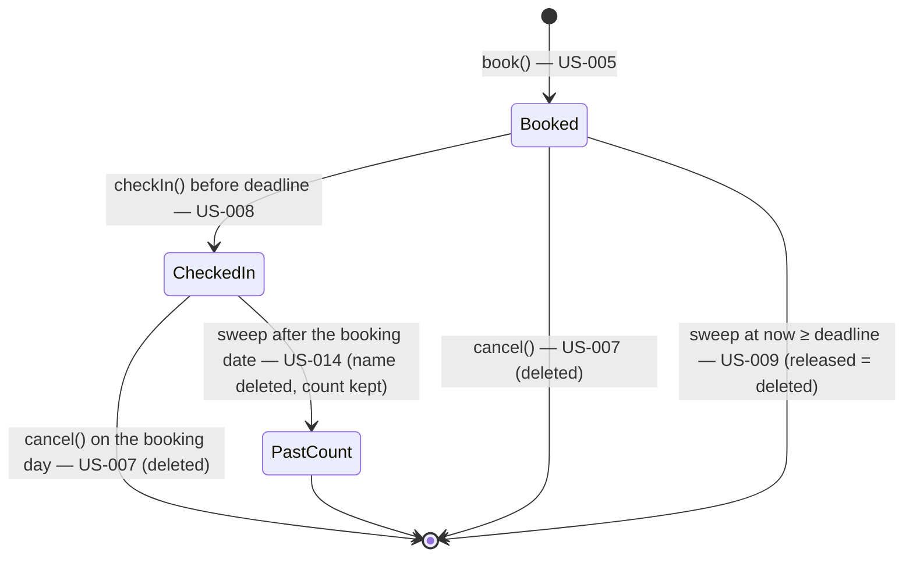

# DeskShare (kit test A) — Data model (browser storage)

| | |
|---|---|
| **Generated by** | `spec` (BA kit) |
| **Date** | 2026-10-22 |
| **Inputs** | `docs/03-backlog/backlog.md`, `stories/US-001…US-017` (Reviewed), `docs/01-requirements/requirements.md`, `docs/02-analysis/analysis-log.md` (DEC-014…DEC-032, ASM-006…ASM-018), `ba-project.yaml` — Confluence `65670` v2, `458755` v1 |
| **Deploy profile** | `static` — `localStorage` only (DEC-014, ASM-006) |
| **Status** | Reviewed (BA, 2026-10-24, after CHG-002…CHG-004) — Revised CHG-004 (2026-10-23, Confluence 1146892 v1, W4: booking note, US-018, DEC-036); was Reviewed (BA, 2026-10-22 — BA review without the technical stakeholder, PoC) |

## 1. Storage location

| Item | Value | Source |
|---|---|---|
| Store | `window.localStorage` of the demo browser — one origin, one device | DEC-014, ASM-006, US-001 |
| Key | `STORAGE_KEY` = `"deskshare-kit:v1"` (config.md §2) — the only key the app writes | profile rule; I-11 |
| Format | one JSON document (§2) | profile rule |
| Access | only through `app/public/js/storage.js`; every `getItem` / `setItem` / `removeItem` in `try/catch` | profile rule; US-001 rule 5 |
| Not stored | the names switch (JS variable only — Off after reload, REQ-038); UI state (selected date / floor) | DEC-021 |

## 2. Stored JSON (version 1)

```json
{
  "version": 1,
  "seededAt": "2026-10-21T08:30",
  "bookings": [
    {
      "date": "2026-10-22",
      "desk": "F1-07",
      "floor": 1,
      "name": "Alex Morgan",
      "nameKey": "alex morgan",
      "showName": false,
      "bookedAt": "2026-10-21T16:00",
      "deadline": "2026-10-22T10:00",
      "checkedInAt": null
    }
  ],
  "pastCounts": {
    "2026-10-21": { "1": 1, "2": 1 }
  }
}
```

| Field | Type | Rule | Source |
|---|---|---|---|
| `version` | integer | must equal `STORAGE_VERSION` (1); otherwise the data is **unreadable** (§5) | profile rule, DEC-031 |
| `seededAt` | office time `YYYY-MM-DDTHH:MM` | time the seed was loaded (information only) | US-002 |
| `bookings[]` | array | active bookings only — cancelled and released bookings are deleted (§4) | REQ-014, REQ-018 |
| `date` | `YYYY-MM-DD` office date | booking date | REQ-001 |
| `desk` | `F<floor>-<NN>` | one of the desks in `FLOORS` | REQ-022, ASM-007 |
| `floor` | 1 \| 2 | derived from `desk`, stored for counting | REQ-002, REQ-003 |
| `name` | text, 1…`NAME_MAX_LENGTH` code points | typed name, leading / trailing spaces removed (I-3) | REQ-006, REQ-035, NFR-004 |
| `nameKey` | text | normalised name: NFC → trim → whitespace runs → one space → lower case (I-3) | REQ-035, ASM-011, ASM-012 |
| `showName` | boolean | consent "Show my name to colleagues"; `false` when booked with the switch Off | REQ-027, US-011 rule 2 |
| `note` | text, 1…`NOTE_MAX_LENGTH` code points — **optional field** | the booking note, trimmed (`cleanNote`); the field is absent when there is no note. Bookings saved before CHG-004 have no `note` and stay valid — storage stays version 1 (DEC-036, I-19) | REQ-046, REQ-047, NFR-012, US-018 |
| `bookedAt` | office time | time of booking (minute precision) | US-017 |
| `deadline` | office time | check-in deadline, computed once at booking (storage.md §2 `deadline()`), I-4 | ASM-008, DEC-024 |
| `checkedInAt` | office time \| `null` | set by check-in | REQ-015, REQ-016 |
| `pastCounts` | `{ date: { floor: count } }` | per-floor count of past dates' bookings that were not cancelled or released; **no names**; never shown | US-014, ASM-014, DEC-029 |

All times are **office time** strings at minute precision (fixed offset UTC+5, config `OFFICE_UTC_OFFSET_MINUTES`), so they compare as strings (I-2).

## 3. Unique rules (no double booking)

| Rule | Check | Enforced in | Source |
|---|---|---|---|
| One booking per desk per date | no two bookings with the same (`date`, `desk`) | `book()` after re-reading storage | REQ-023, US-005 rule 3, rule 7 |
| One booking per name per date | no two bookings with the same (`date`, `nameKey`) | `book()` after re-reading storage | ASM-011, REQ-035 |
| Floor not over capacity | count(`date`, `floor`) < desks of the floor | `book()`; follows from rule 1 since capacity = desk count | REQ-011, REQ-024 |
| Seed obeys the same rules | checked by `test/unit/seed.test.js` | seed | US-002 rule 4 |

Every write operation runs **read → sweep → check → write** in one synchronous call (storage.md §3), so a stale tab cannot double-book (US-005, US-006, US-007 two-tab scenarios). Two writes from two tabs in the same instant are not locked (I-14).

## 4. Lifecycle of a booking



| Transition | When | Effect | Source |
|---|---|---|---|
| book | user action | booking added; desk taken; booked +1 | REQ-008, REQ-023 |
| check-in | user action, booking day, `now < deadline` | `checkedInAt` = now; never released | REQ-016, REQ-037 |
| cancel | user action, booking date ≥ today | booking deleted; desk free; booked −1 | REQ-014, ASM-012 |
| release | sweep: `checkedInAt = null` and `now ≥ deadline` | booking deleted; desk free; booked −1 | REQ-017, REQ-018, DEC-020 |
| retention | sweep: `date < today` (office date) | `pastCounts[date][floor] += 1`; booking deleted (name gone) | US-014, ASM-014, DEC-029 |

**Sweep** = release, then retention. It runs inside every read and every write (storage.md §3) — on every user action and every `REFRESH_INTERVAL_SECONDS` while the app is open (DEC-028), and on opening the app. Nothing runs while the app is closed; the next open catches up (US-009 "released without anyone using the app", US-014 "after days without use"). A past-date booking still in storage is always checked in, because every deadline is ≤ 23:59 of its date.

Retention (US-014) is in the **Next** band: until US-014 is built, sweep does release only, and past bookings stay stored but are never shown (past dates cannot be selected — ASM-010).

## 5. States of the store

| State | Detected by | App behaviour | Source |
|---|---|---|---|
| **Empty** — no key | `getItem` returns `null` | load the seed (demo-data.md), save, render | US-002, REQ-034 |
| **Ready** | JSON parses and `version = 1` | normal | — |
| **Unavailable** — storage blocked / throws | `getItem` or a test `setItem` throws | message "Bookings cannot be saved in this browser — browser storage is turned off."; empty grid; no Book / Cancel / Check in | US-001 rule 5 |
| **Unreadable** — damaged JSON or other `version` | `JSON.parse` throws or `version ≠ 1` | message "Saved bookings could not be read in this browser. Clear site data to reload demo data."; data **left unchanged**; no Book / Cancel / Check in | DEC-031, REQ-043 |
| **Write failed** — quota or eviction | `setItem` throws during an operation | operation result `STORAGE_OFF`; nothing changed | US-001 rule 5 |

## 6. Version change and reset

| Case | Rule | Source |
|---|---|---|
| New storage version in a later build | new key `deskshare-kit:v2`; v1 data is unreadable for the new build → DEC-031 message; the team clears site data. No migration code in the PoC (one version) | DEC-031, CST-008 |
| Reset — local / test build | `?reset-demo` on `localhost` / `127.0.0.1`: `removeItem(STORAGE_KEY)` → seed → save → parameter removed from the URL (`history.replaceState`) | REQ-034, REQ-044, DEC-031 |
| Reset — deployed build | `?reset-demo` ignored. The team clears the site data in the browser (README, demo-data.md §9) → Empty → seed | REQ-044, DEC-031 |
| Never | `localStorage.clear()` — the GitHub Pages origin is shared with other sites of the account (I-11) | I-11 |

## 7. Retention summary (what is deleted when)

| Data | Deleted | Source |
|---|---|---|
| Cancelled booking | at once | REQ-014 |
| Released booking | at the first sweep at or after its deadline | REQ-018 |
| Names of past dates | at the first sweep after the booking date (US-014, Next band) | ASM-014 |
| Notes | with their booking: at once on cancel, at the first sweep at or after the deadline when released, at the first sweep after the booking date (whole booking deleted, US-014) | REQ-050, US-018 (CHG-004) |
| Per-floor counts of past dates | kept, never shown | DEC-029 |
| Everything | clearing site data, or `?reset-demo` in the local / test build | DEC-031 |
